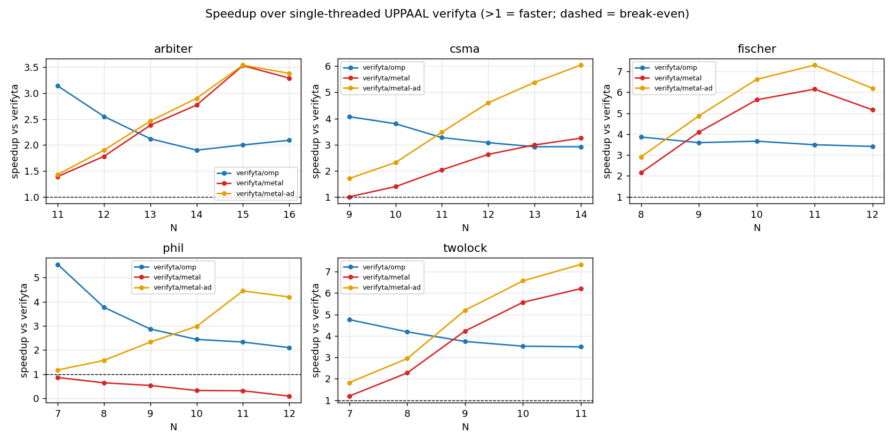

# PTCTLMC — A Guide to the Parallel Timed‑Automata Model Checker and Its Evaluation

PTCTLMC verifies **networks of timed automata** — the formalism UPPAAL uses to model
real‑time and concurrent systems (mutual‑exclusion protocols, communication protocols,
schedulers) whose correctness depends on *timing*. Given such a model and a query, it
decides questions like "can two processes ever be in their critical section at the same
time?" by exhaustively exploring a finite **symbolic** representation of an infinite
(real‑valued‑clock) state space.

The headline result of this project: PTCTLMC's parallel backends — **`omp`** (12‑core CPU)
and **`metal`** (Apple GPU) — beat single‑threaded UPPAAL `verifyta` by **up to ~5×** on the
same models *while exploring provably the same state space* (exact, integer‑for‑integer
count parity). On the **merge‑light** benchmarks (Fischer, two‑lock, arbiter) the Metal GPU
backend additionally beats the 12‑core CPU backend across the useful problem sizes; the
evaluation (§11) is equally explicit about where the GPU does **not** pay off — on
**merge‑heavy** models (dining philosophers), where per‑bucket work dominates and the GPU's
one‑thread‑per‑bucket merge kernel is the wrong shape, and at the very top of the memory
range, where the GPU's extra buffering hits the 24 GB ceiling first.

## Who this is for / how to read this guide

The reader is assumed to be a strong software engineer who is **not** a timed‑automata or
model‑checking specialist. Every domain term is defined the first time it appears.

- **Sections 2–5** are background theory: timed automata (§2), the verification problem and
  symbolic states (§3), difference bound matrices (§4), and how the search terminates (§5).
- **Sections 6–10** are the engine itself: the core algorithm (§6), the four backends —
  sequential/OpenMP (§7), Metal GPU (§8), CUDA (§9) — and an honest account of the
  optimization journey, including the dead ends (§10).
- **Sections 11–12** are the evaluation: the benchmark methodology and fairness controls
  (§11) and a copy‑pasteable runbook to reproduce everything (§12).

If you only want the results, jump to **§11**. A glossary of every term is in the
**Appendix**.

## Table of contents

1. Overview: what PTCTLMC is and the headline result
2. Background: timed automata and networks of them
3. Background: the verification problem and symbolic states
4. Background: difference bound matrices (DBMs)
5. Background: termination — subsumption and the exact convex‑union merge
6. The core algorithm: level‑synchronized BFS
7. Backends I: sequential and OpenMP
8. Backends II: the Metal GPU engine
9. Backends III: the CUDA mirror
10. The optimization journey: what worked and what did not
11. The benchmark suite and evaluation methodology
12. Reproducing the results
- Appendix: Glossary

---

## 1. Overview: what PTCTLMC is and the headline result

A **timed automaton** is a finite‑state machine equipped with real‑valued **clocks** that
all advance at the same rate; edges can be *guarded* by clock conditions and can *reset*
clocks. A **network of timed automata** is several such machines running in parallel and
synchronizing. This is exactly UPPAAL's modeling language, and it is expressive enough to
capture the timing‑critical concurrency bugs that ordinary (untimed) model checkers miss —
for example, Fischer's mutual‑exclusion protocol is *correct only because of the timing*
of its delays.

PTCTLMC answers two kinds of question about such a model:

- **Reachability**, written `E<> p`: "is there a run that reaches a state satisfying `p`?"
- **Safety**, written `A[] p`: "does `p` hold in *every* reachable state?" — equivalently
  `A[] p ≡ ¬ E<> ¬p`.

It computes the answer by symbolic reachability (§3) and reports it together with two
counts that are the currency of the fairness comparison against UPPAAL: the number of
symbolic states **explored** (expanded) and **stored** (retained after pruning).

The same algorithm runs on four interchangeable **backends**, selected with `--backend`:

| backend | hardware | role |
|---------|----------|------|
| `seq`   | 1 CPU thread | reference implementation; deterministic parity oracle |
| `omp`   | 12 CPU cores (OpenMP) | the fast portable path; wins on merge‑heavy models |
| `metal` | Apple GPU + 12 CPU cores | fastest on merge‑light models (Fischer, two‑lock, arbiter) |
| `cuda`  | NVIDIA GPU (e.g. H100) | the same engine for datacenter GPUs |

The rest of this guide explains how each layer works and how the evaluation establishes
the headline numbers.

---

## 2. Background: timed automata and networks of them

**A timed automaton.** Formally it is a finite set of **locations** (control states) and
**edges** between them, plus a set of **clocks** — real‑valued variables that all increase
at rate 1 as time passes. The pieces that make it *timed*:

- A **guard** on an edge is a condition (on clocks and/or integer variables) that must hold
  for the edge to be taken, e.g. `x >= 4`.
- An **invariant** on a location is a clock condition that must remain true *while the
  system sits in that location*, e.g. `x <= 6`. Invariants force progress: the automaton
  cannot let time pass beyond the invariant, so it must eventually take an edge out.
- A **reset** sets a clock back to 0 when an edge is taken, e.g. `x := 0`.

At any instant the automaton is in one location with some real value for every clock. Two
things can happen: a **delay** (all clocks advance by the same amount, staying within the
current invariant) or an edge **action** (a guard is satisfied, the edge is taken, its
clocks are reset). In the code, a location carries its invariant and two flags — `urgent`
and `committed` — and an edge carries its guards, resets, and (optionally) a channel
synchronization (`include/ptctlmc/network.hpp:24`, `NEdge`).

**A network** is several timed automata composed in parallel (`Network`,
`include/ptctlmc/network.hpp:42`). The global **discrete state** is the vector of each
process's current location *plus* the values of any shared bounded **integer variables**
(`IntVar`, `network.hpp:15`); the clocks are shared across the whole network. Processes
interact three ways:

- **Shared integer variables.** An edge can read them in its guard (`IntAtom`, e.g.
  `turn == i`) and write them in its update (`IntAsgn`, e.g. `turn := i`). PTCTLMC's model
  parser restricts updates to *constants* and clock resets to *0*, which keeps the discrete
  state finite and cheaply encodable (§6).
- **Binary channels** (`chan a`). One edge labeled `a!` (send) synchronizes with exactly
  one edge labeled `a?` (receive) in a *different* process; both edges fire together in a
  single atomic step, a **handshake**.
- **Broadcast channels** (`broadcast chan a`). One `a!` sender fires together with *all*
  currently‑enabled `a?` receivers (zero or more). Unlike a binary handshake, a broadcast
  sender can always fire, even if no one is listening. The flag lives in
  `Network::chan_broadcast` (`network.hpp:47`).

Two location flags remove time: an **urgent** location lets no time pass (you must leave
before any delay), and a **committed** location is urgent *and* takes scheduling priority —
the next step must involve a committed process. These model atomic sequences.

**A concrete example.** The generator `benchmarks/generators/gen_fischer.py` emits Fischer's
protocol: each process `Pi` has locations `idle → req → wait → cs`, one clock per process,
guards like `x <= k` / `x > k` that create the timing race, and a shared integer `turn`
that the processes read and write to arbitrate. The correctness property is that no two
processes are ever in `cs` simultaneously — true *only* because the clock bounds are chosen
so that a process that "moved too fast" is forced to retry.

---

## 3. Background: the verification problem and symbolic states

We want to decide `E<> p` (reachability) or `A[] p` (safety). The obstacle is that the
concrete state space is **infinite**: a state includes the real values of every clock, and
there are uncountably many. We cannot enumerate concrete states.

**The zone abstraction.** The escape is that the reachable clock valuations, grouped by
discrete state, always form **zones**. A *zone* is a convex set of clock valuations
describable by simple constraints: bounds on individual clocks (`x <= 5`, `x > 2`) and on
pairwise *differences* (`x - y <= 3`). A **symbolic state** is then a pair:

```
(discrete part: locations of all processes + integer‑variable values,  zone: a convex set of clock valuations)
```

One symbolic state stands in for infinitely many concrete states. Crucially, there are only
finitely many *distinguishable* zones once we bound them (§5), so the **zone graph** — the
graph whose nodes are symbolic states and whose edges are "compute the time‑successor and
the edge‑successors" — is finite, and ordinary graph search over it decides the query.

**Explored vs stored.** Two counts describe a search and they are *not* the same number:

- **explored** symbolic states = how many were popped from the frontier and expanded.
- **stored** symbolic states = how many were *retained* in the passed set after pruning
  (§5). A state can be explored but later found redundant, and re‑derivations of an
  already‑stored discrete/zone pair are explored again.

PTCTLMC prints both (`PTCTLMC_STATS=1` → `stored-zones=N` and `explored N symbolic states`),
and UPPAAL prints both (`States stored` / `States explored`). Matching them is the
fairness proof of §11: `stored-zones ≡ States stored` and `explored ≡ States explored`.

The search is driven by two routines in `src/netreach.cpp`: `successors_net` (compute the
symbolic successors of one symbolic state, §6) and `reachable_net` (the search loop that
uses them, `netreach.cpp:278`).

---

## 4. Background: difference bound matrices (DBMs)

A zone must be stored and manipulated efficiently. The standard representation is a
**difference bound matrix (DBM)**. Add a fictitious **reference clock** `x0` that is always
0; then *every* zone constraint — whether a bound on a single clock `xi` or on a difference
`xi − xj` — has the uniform shape `xi − xj ≤ c` (a bound on `xi` is just `xi − x0 ≤ c`). A
zone over `n` clocks is therefore an `(n+1) × (n+1)` matrix `D` where `D[i][j]` is the
tightest known upper bound on `xi − xj`.

**Encoding (`include/ptctlmc/dbm_ops.hpp:6,19`).** Each bound is a value *and* a
strict/non‑strict flag, packed into one 32‑bit word `raw_t` as `raw = (value << 1) | weak`
(`weak = 1` for `≤`, `0` for `<`). This lets `< 5` and `≤ 5` be compared as plain integers,
and `kInf = 1<<30` represents "no bound". Adding two bounds (`raw_add`, `dbm_ops.hpp:28`)
adds the values and takes `≤` only if both were `≤` — the arithmetic of the shortest‑path
closure below.

**Canonical form.** The same zone has many DBM representations; a unique **canonical** one
is obtained by tightening every bound to its implied minimum via all‑pairs shortest paths
(Floyd–Warshall), `dbm_close` (`dbm_ops.hpp:36`), which is `O(dim³)`. Canonicalization is
required both for a unique fingerprint and for the inclusion test to be a simple entrywise
comparison.

**Operations the successor pipeline needs**, each a small function over the flat array:

- **Conjoin a guard/invariant** `xa − xb < c`: `dbm_constrain` (`dbm_ops.hpp:69`) tightens
  the single entry and re‑closes *incrementally* in `O(dim²)` — valid because the matrix
  was canonical and only one edge changed. `dbm_intersect` (`:89`) conjoins a whole zone.
- **Delay** (let time advance): `dbm_delay` (`:54`) drops every clock's upper bound to `kInf`
  (all clocks can grow without bound), after which invariants are re‑applied. This is the
  "time passes" transition.
- **Reset a clock to 0**: `dbm_reset` (`:58`).
- **Emptiness / consistency**: `dbm_empty` (`:48`) — a zone is empty iff some diagonal
  entry went negative (a clock would have to be less than itself).
- **Inclusion** `Z' ⊇ Z` (is every valuation of `Z` also in `Z'`?): entrywise `≤` on
  canonical DBMs, `dbm_includes` (`:173`).

Most operations are `O(dim²)`; closure is `O(dim³)`. The whole algebra is written as
`__host__ __device__` free functions so the *identical* code runs on the CPU and inside GPU
kernels (§8–§9) — this is what keeps the four backends bit‑for‑bit consistent.

---

## 5. Background: termination — subsumption and the exact convex‑union merge

Two mechanisms keep the search finite and small.

**(1) Subsumption + extrapolation.** If a newly generated symbolic state's zone is already
covered by a stored zone with the same discrete part, the new one teaches us nothing and is
discarded. Plain zone *inclusion* (`dbm_includes`) is one such test, but it is too weak to
guarantee termination on its own, because clock values can grow unboundedly. The fix is
**extrapolation**: past the largest constant any guard ever compares a clock against, the
exact value no longer matters, so we widen the zone. PTCTLMC implements the modern
**Extra_LU+** abstraction (`dbm_extrapolate_lu_plus`, `dbm_ops.hpp:130`), parameterized by
per‑clock constants `L[i]` (max **l**ower‑bound constant) and `U[i]` (max **u**pper‑bound
constant); this yields a *finite* zone graph while preserving the verdict, and a
diagonal‑safe variant (`:154`) keeps difference constraints exact on models with diagonal
guards, where naive extrapolation would be unsound (Bouyer 2004).

PTCTLMC actually goes one better and prunes with the **aLU preorder** subsumption test,
`dbm_is_alu_le` (`dbm_ops.hpp:187`) — a line‑for‑line port of the tchecker abstraction from
Herbreteau–Srivathsan–Walukiewicz (LICS'12). It answers "is exploring `Z` guaranteed to
discover nothing beyond stored `Z'`?" and is strictly *coarser* than inclusion, so it prunes
far more. To make it as coarse as UPPAAL's, the `L`/`U` bounds are computed **per location**
by static guard analysis (`Network::lbound_loc`/`ubound_loc`, `network.hpp:55`) and combined
per discrete state at merge time (`state_bounds`, `netreach.cpp:302`). A companion
**active‑clock reduction** resets any clock that no reachable guard will read
(`Network::active`, `network.hpp:58`), collapsing zones that differ only in a dead clock.

**(2) The exact convex‑union merge.** Even after subsumption, one discrete state may hold
several incomparable zones. Sometimes their *set union* happens to be convex — i.e. is
itself a single zone. `dbm_try_union` (`dbm_ops.hpp:207`) detects exactly this case (by
checking that crossing each facet of one zone lands inside the other) and, when it holds,
replaces the two zones by their hull. This is **exact** — it adds no spurious valuations —
and it is what collapses the stored antichain down to UPPAAL's stored‑state count. It runs
inside `add_to` (`netreach.cpp:407`).

**The order‑sensitivity consequence.** Because `try_union` fires opportunistically, *which*
pairs merge depends on the order zones arrive. Under parallel scheduling that order is
nondeterministic, so the **stored count varies by a handful of states run to run** — for
example dining philosophers at N=8: `seq` = 6992 (stable), `omp` = 6953–7002, `metal` =
7006, a 0.2 % spread. This is always **sound** (the verdict is identical and correct — it is
the same reachable space partitioned into a slightly different number of convex zones). The
practical rule, used throughout the evaluation: the deterministic `seq` backend is the one
that matches UPPAAL *exactly*, so parity is measured on `seq`; the parallel backends are
checked only for verdict agreement.

---

## 6. The core algorithm: level‑synchronized BFS

The search is a breadth‑first exploration of the zone graph, organized in **levels** (BFS
frontiers) so that whole frontiers can be expanded in parallel. The driver is
`reachable_net` (`src/netreach.cpp:278`).

**The passed set as discrete‑keyed buckets.** All stored symbolic states are grouped by
their discrete part. The discrete part is packed **losslessly into a single 64‑bit integer**
(`disc_key`, `netreach.cpp:379`): each process's location and each integer variable gets a
fixed bit‑field wide enough for its range (`bits(...)`, `:363`), and the fields are
concatenated. Integer variables are offset by their low bound so the packing is injective
across `[lo, hi]`. If the whole discrete state needs ≥ 64 bits the driver throws rather than
silently corrupting keys (`netreach.cpp:370`). Comparing and hashing discrete states is then
a single integer op — the same trick UPPAAL calls "compressed integer" discrete states, and
a large profiler win over the old string keys.

**One level.** Starting from the initial symbolic state (built by the same zone pipeline,
`netreach.cpp:417`), each level does:

1. **Expand** every symbolic state in the current frontier into its successors
   (`successors_net`).
2. **Route** each successor to the bucket for its discrete key.
3. **Merge** each bucket: run subsumption + the convex‑union merge (`add_to`,
   `netreach.cpp:392`) to keep only an antichain of zones.
4. **Collect** the zones that were *newly added this level* — they form the next frontier.

Repeat until the frontier is empty (whole state space explored → `A[] p` holds) or a target
state is found (→ `E<> p` holds).

**The successor pipeline (`successors_net`, `netreach.cpp:121`).** For one symbolic state,
successors come from three sources, each producing a new symbolic state through the *same*
zone pipeline:

- **Local edges** (`:126`) — an unsynchronized edge whose integer and clock guards hold.
- **Binary handshakes** (`:156`) — every `a!`/`a?` pair across two different processes.
- **Broadcasts** (`:199`) — an `a!` sender together with the cross product of each other
  process's enabled `a?` edges (each receiver independently chosen).

For each candidate the pipeline is: check integer guard → copy the zone → conjoin clock
guard(s) → apply resets → conjoin the combined location **invariants** → **delay** (unless a
participant is urgent/committed) → re‑apply invariants → **reset inactive clocks** →
optionally extrapolate → drop if empty (`netreach.cpp:132–152`). Committed locations are
honored by filtering which processes may move (`:127`, `:169`, `:222`). The result is the
exact set of symbolic successors, ready to be routed and merged.

---

## 7. Backends I: sequential and OpenMP

**Sequential (`seq`).** The straightforward single‑threaded realization of §6: one loop over
the frontier calling `successors_net`, one pass routing successors into a single passed map,
one pass merging each touched bucket with `add_to`. Because it is deterministic it doubles as
the **correctness and parity oracle** — its stored/explored counts are the ones compared
against UPPAAL.

**OpenMP (`omp`) — the shared‑passed hybrid.** The default CPU backend is a **hybrid of
LTSmin's parallel architecture and PTCTLMC's exact merge** (`--shared-passed`, on by
default; `--legacy-passed` restores the old static‑shard design below for A/B). The design
mirrors the FORMATS'12 opaal+LTSmin algorithm — *one* shared passed/waiting table with
**fine‑grained locking and no static partition** — but keeps PTCTLMC's exact‑zone aLU +
convex‑union merge as the per‑bucket operation. Three ideas compound:

- **Shared, stripe‑locked table (no serial barrier).** The passed set is one table split
  into `NB ≫ nthreads` lock stripes. Any worker may insert any discrete state, taking only
  that state's stripe lock. Expansion and insertion are **fused** — a frontier state's
  successors go straight into the table — so there is no serial per‑level routing pass (the
  Amdahl ceiling of the old design). Strict‑BFS level synchronization is kept (it minimizes
  the state count). At one thread it is bit‑identical to `seq`.

- **Zone interning.** Symmetric models reach millions of states but few *distinct* zones
  (viking15: 2.77 M states, **120** distinct DBMs). Each distinct zone is stored once
  (`ZoneIntern`) and every passed node holds a 4‑byte zone **index**; interned zones are
  immutable (subsumption/`try_union` only read them), so lookups are lock‑free after a
  per‑thread warm‑up. This collapses the resident zone set from ~1.5 GB to ~69 KB
  (L2‑resident) and removes the large‑model memory‑bandwidth wall.

- **Storage reuse.** The frontier holds `(dk, zone‑index)` — 12 B, not a full state; locs/ints
  are reconstructed from the packed key and the parent zone is passed by reference. And
  `gen_succ_reuse` builds each successor **in place** in a reused buffer, so the per‑successor
  loc/int/zone allocation (tens of millions of pooled alloc/free pairs) drops to zero after
  warm‑up.

**The per‑thread DBM pool** still backs the transient zone algebra (`include/ptctlmc/dbm_pool.hpp`):
a free‑list of zone‑sized blocks, allocation a pointer pop, never returned to the global
allocator during a run — no `malloc` lock contention across threads.

**Legacy design (`--legacy-passed`).** The original CPU backend sharded the passed set
**statically** by discrete key (`shard_of(dk)`), one shard per thread, with a *serial*
per‑level routing pass into `byshard` before a lock‑free parallel merge. Kept as an A/B
baseline; the shared‑passed hybrid is **3–4.3× faster** on viking (the gap grows with N).

**How it does.** The hybrid **beats opaal+LTSmin on all four viking sizes** — LTSmin's own
benchmark — at 8 threads (viking10 2.9×, viking12 1.6×, viking15 1.08×, viking17 1.67×), and
**crushes Fischer** (~1000× at N=6; LTSmin's extrapolation explodes |Σ|/|S| to ~50 where
PTCTLMC's convex merge keeps it ≈1). See §11 and `LTStest/results/HYBRID_FINDINGS.md`.

---

## 8. Backends II: the Metal GPU engine

The Metal backend (`src/metal/netengine_metal.mm`, behind the interface
`include/ptctlmc/net_gpu.hpp`) runs the whole level loop — expand *and* merge — on the Apple
GPU. It is the most novel part of the system, and getting it to beat the 12‑core CPU took
eliminating host overhead, not adding GPU compute (§10).

**A flat, GPU‑resident driver.** The CPU path stores rich `SymState` objects; the GPU path
does not. Instead the passed set is a flat `unordered_map<uint64 dk, vector<raw_t>>` — a
bucket is just a contiguous run of zone words — and everything stays as flat zone arrays
across levels (the "FLAT GPU‑resident driver", `netreach.cpp:435`). There is no per‑level
marshaling of objects.

**Unified memory.** On Apple silicon the CPU and GPU share physical RAM. Buffers are
allocated `MTLResourceStorageModeShared`, so a buffer's `.contents` pointer is written by the
host and read by the GPU **with no copy**: the host gathers zone data straight into the
buffer the kernel will read. Buffers are **persistent and grow‑on‑demand** (reused across
levels, only reallocated when a level needs more room).

**Two kernels.**

- **`net_expand`** — one GPU thread per successor **recipe**. A recipe is a participant list:
  one edge (a local step), two edges (a binary handshake), or one sender + K receivers (a
  broadcast). Each thread runs the full §6 zone pipeline on its own zone. The host enumerates
  *which* recipes exist (mirroring `successors_net`'s channel logic) and hands the kernel a
  flat description; the kernel is the pure zone arithmetic, which is where the parallelism
  pays.
- **`net_merge`** — one GPU thread per discrete‑state bucket, replicating `add_to` *exactly*,
  including aLU subsumption and the convex‑union merge (using the device‑callable DBM ops of
  §4). Buckets are independent, so this is embarrassingly parallel.

**In‑place readback.** The kernels' outputs are exposed to the host as `const raw_t*&`
pointers *into* the persistent buffers (see the `expand`/`merge` signatures in
`net_gpu.hpp:36,63`) — the host reads results straight out of unified memory, with no
compaction copy. The host‑side marshaling and passed‑list rebuild that remain are themselves
run **OpenMP‑parallel**, so this backend is genuinely *GPU + 12 CPU cores*.

**The new‑gather elimination (the win).** Originally the host copied every successor ("new")
zone twice — once to stage it into the merge's work buffer, once to read the merged result
back. The fix (reflected in the `stage_merge`/`merge` interface, `net_gpu.hpp:55–63`): the
merge kernel reads **new zones in place** from the expand kernel's output buffer, indexed by
a `new_idx` array; the host only stages the *existing* antichain. This halved the host memcpy
profile (16242 → 8425 sampled frames) and flipped the largest problem from a loss to a win
(§10, §11).

**Adaptive merge routing (`--adaptive`).** The merge kernel's *one thread per bucket* is the
right shape only when a level has *many, thin* buckets (Fischer: ~70k buckets, each a tiny
antichain) — thousands of GPU lanes each do a little work. It is the *wrong* shape when the
per‑bucket work is heavy: on dining philosophers the exact convex‑union merge (§5) fires
constantly, so each of a few thousand buckets carries an `O(k²·dim³)` load, and a handful of
weak GPU lanes grind through it while the CPU cores sit idle. The profiler makes this stark —
the merge kernel is **~93 % of the Metal wall‑clock on philosophers** versus **~31 % on
Fischer**. Tellingly, *static* bucket‑size heuristics (bucket count, mean/max antichain size)
do **not** separate the two cases, because the discriminator is the branchy convex‑union cost,
which those metrics don't see. So the tool *measures* instead.

With `--adaptive`, the flat driver **calibrates** the two merge paths and routes each level to
the faster one:

- It has a **host port of the merge kernel**, `flat_merge_bucket` (`netreach.cpp`), that runs
  the identical aLU‑subsumption + convex‑union logic on the CPU using the same `dbm_ops.hpp`
  functions (`dbm_is_alu_le`, `dbm_try_union`, `dbm_includes`), parallelized across buckets with
  `#pragma omp parallel for` — i.e. the merge on all 12 cores instead of one GPU thread each.
- For each BFS level it estimates the merge work as `Σ_b bucket_b²` and records each path's
  **throughput** (work per millisecond). It calibrates the CPU path first (never catastrophic),
  then the GPU path, then routes every later level to whichever has the higher measured
  throughput, updating the estimate as it goes. **Expansion always stays on the GPU** — only the
  merge is routed.

Because this lives in the **shared** flat driver, not in device code, **CUDA gets it for free**.
The knob is a CLI flag (`--naive`, the default = the original one‑thread‑per‑bucket merge, vs
`--adaptive`), set once via `set_adaptive_merge()` (`netreach.hpp`). The payoff is large where it
matters and harmless elsewhere: on philosophers N=11 the Metal wall drops from **8.1 s (naive) to
0.6 s (adaptive)** — a **13×** speedup that turns metal's worst loss into a *win* over both OpenMP
(1.2 s) and `verifyta` (2.6 s) — while Fischer, already merge‑light, still improves slightly
(2.64 → 2.31 s). This does **not** apply to the OpenMP backend, whose merge is *already* the
parallel‑across‑buckets CPU merge (it never had the one‑thread‑per‑bucket pathology); an
`omp --adaptive` would toggle nothing.

**Scope and fallback.** The GPU path handles **non‑diagonal** networks with shared integers,
binary channels, broadcast channels, and urgent/committed locations. If the model uses
diagonal clock constraints (`x − y ≤ c` between two real clocks), or no GPU is present, the
factory `make_net_gpu_metal` returns `nullptr` and `reachable_net` transparently falls back
to the CPU path (`netreach.cpp:340–346`).

---

## 9. Backends III: the CUDA mirror

The CUDA backend (`src/cuda/netengine_cuda.cu`) is a **device‑for‑device mirror** of the
Metal engine so the identical algorithm runs on an NVIDIA GPU (developed against an H100).
Three design choices keep the two engines from drifting apart:

- **Shared DBM algebra.** The zone operations in `dbm_ops.hpp` are annotated
  `__host__ __device__` (§4), so CUDA kernels call the *same* code the CPU unit tests
  validate. Only the convex‑union needed a device twin: the host `dbm_try_union` is
  `inline`‑only and uses a large fixed `kDbmMaxDim` scratch array, so the `.cu` file provides
  a `d_try_union` with a smaller device‑appropriate scratch — the sole device‑specific piece
  of the zone algebra.
- **Shared encoding.** The translation from a `Network` into the flat arrays the kernels
  consume lives in `include/ptctlmc/net_gpu_encode.hpp` and is `#include`d by *both* engines,
  so a model is encoded identically for Metal and CUDA.
- **Shared driver via unified memory.** CUDA buffers use `cudaMallocManaged` (CUDA unified
  memory), which lets the *same* flat driver in `netreach.cpp` — written against the
  backend‑neutral `NetGpuExpander` interface (`net_gpu.hpp`) — work unchanged;
  `make_net_gpu_cuda` mirrors `make_net_gpu_metal` field for field.

Because the Mac cannot compile or run CUDA, this backend is built and tested on the NVIDIA
host separately; the shared encoding + shared interface + shared DBM ops are precisely what
make that safe (the two engines share every non‑device‑specific line). When you change one
engine's interface, you change `net_gpu.hpp` and both follow.

---

## 10. The optimization journey: what worked and what did not

A good evaluation reports the dead ends too. The Metal backend's path to beating the 12‑core
CPU was **guided by the profiler**, and the recurring lesson is that on Apple‑silicon unified
memory the enemy is host‑side data movement, not GPU compute.

**Starting point.** The first GPU version round‑tripped rich `SymState` objects to and from
the device each level; the profiler showed the time went into host `memcpy`/marshaling, not
kernels. That drove the rewrite to the **flat GPU‑resident driver** (§8): flat zone arrays,
unified‑memory buffers, in‑place readback.

**The win — new‑gather elimination.** Profiling the flat driver showed the host still copied
every successor zone twice. Making the merge kernel read new zones *in place* (§8) removed
one full pass over the successor zones: the memcpy profile halved (16242 → 8425 samples) and
the largest measured problem in that model, Fischer N=12, went from **~17.6 s (losing to
`omp`'s ~15.6 s)** to **~12.2 s (winning)**. This single change is what lets Metal beat OpenMP
across the merge‑light benchmarks (§11); it does not rescue the merge‑heavy case, which is
limited by the merge kernel's shape, not by host copies.

**Two experiments that regressed — and were reverted.** Both are honest negative results and
both fail the same way:

1. **GPU‑resident append‑only arena.** Keep the passed‑list zones resident on the GPU
   (`dk → (offset, count)`), have the merge read the existing antichain in place and append
   survivors, with periodic host compaction. It was exact but *slower at every size*, because
   the merge kernel then had to copy each bucket's antichain **single‑threaded per bucket on
   the GPU** (versus the host's 12‑core gather), plus the compaction did multi‑GB host
   `memmove`s.
2. **Frontier‑buffer optimization.** Write the next frontier's zones directly into a
   persistent GPU buffer instead of gathering them. It regressed Fischer N=12 (12.2 → 14.0 s),
   because it turned a large sequential gather into **scattered CPU writes into GPU‑shared
   memory**, which are slow once the working set is large.

**The transferable lesson.** On unified memory, keep host↔GPU traffic as large *sequential*
gathers and let the 12 CPU cores do them in parallel; scattered host writes into GPU‑facing
buffers do not pay at large working sets. Trust the profiler, not intuition, about where the
time is.

**A kept micro‑optimization.** `skip-rebuild`: a bucket whose merge produced **0 survivors**
(every new zone was subsumed) is unchanged, so its passed‑list rebuild and frontier gather are
skipped entirely.

### 10a. The CPU hybrid: catching opaal+LTSmin on *their* benchmark

The same profiler‑guided discipline, applied to the `omp` backend, closed the gap with the
FORMATS'12 opaal+LTSmin tool on the discrete‑heavy **viking** model (LTSmin's home turf). Each
step is exact (state counts identical to `--legacy-passed`, verified on viking *and* Fischer):

1. **Shared table replaces static shards (`--shared-passed`).** The old design's *serial*
   per‑level routing pass was an Amdahl ceiling (1→2 threads only 1.45×). Replacing it with one
   stripe‑locked table and **fused expand+insert** removed the barrier: viking15 scaling went
   from 2.1× to 4.1× on 8 threads. This is LTSmin's Alg. 3/4 shape, with our exact merge kept
   as the per‑bucket op.
2. **Zone interning.** `PTCTLMC_STATS` revealed viking15 stores 2.77 M zones but only **120
   distinct** ones. Storing each distinct DBM once and referencing it by index collapsed the
   resident zone set (~1.5 GB → ~69 KB, L2‑resident), flipping viking17 from a loss to a win.
3. **Frontier + successor storage reuse.** The frontier was shrunk to `(dk, zone‑index)` and
   `gen_succ_reuse` builds each successor **in place** in a reused buffer — the profiler showed
   the residual cost was ~40 M per‑successor pooled alloc/free pairs (a fresh `SymState` per
   successor that `add()` immediately discards), *not* thermal throttling as first suspected.
   Eliminating it took viking17 from ~12 s to **8.2 s** and viking15 to **1.24 s**.

Result: `omp` **wins all four viking sizes** (10 2.9×, 12 1.6×, 15 1.08×, 17 1.67× at 8
threads) and stays **~1000× ahead on Fischer**. Full numbers and the opaal soundness fix that
made the Fischer comparison possible (opaal could not compile the `id != k` guards) are in
`LTStest/results/HYBRID_FINDINGS.md`.

---

## 11. The benchmark suite and evaluation methodology

The goal is a defensible, TACAS‑grade comparison against single‑threaded UPPAAL `verifyta`.
The design and its fairness controls live in `docs/benchmark-suite.md`; the harness is
`benchmarks/bench_run.py`.

**The model set (different characteristics on purpose).** Generators in
`benchmarks/generators/` produce UPPAAL‑compatible XML at scale:

| model | generator | stresses |
|-------|-----------|----------|
| Fischer | `gen_fischer.py` | shared‑integer mutual exclusion; the canonical timed benchmark |
| two‑lock | `gen_twolock.py` | two shared integer variables |
| arbiter | `gen_arbiter.py` | binary‑channel handshakes; *no* zone merging (every state distinct) |
| CSMA/CD | `gen_csma.py` | broadcast synchronization |
| philosophers | `gen_phil.py` | many binary channels; **few discrete states, large zone antichains** — the merge‑heavy case (CPU‑favorable) |
| train‑gate | `gen_grc.py` | counters in locations (and order‑sensitive counts) |

**Queries must force full exploration.** A *satisfiable* `E<> p` query stops the instant it
finds the target, exploring almost nothing (and in an order‑dependent way) — useless for
scaling or parity. So every timed query is a **safety property that holds** (`A[] p`), which
forces the *entire* reachable space to be explored. This mattered in practice: for CSMA,
`E<> Bus.Collided` explored ~4 states, whereas the safety property "two stations are never
both `Send` while the bus believes it is cleanly `Transmitting`" explores the full space.

**Fairness — state‑count parity is mandatory.** A speedup over a tool doing *more* work is
meaningless, so the #1 control is that PTCTLMC and UPPAAL explore the *same* state space.
Using the metric mapping `stored-zones ≡ States stored` and `explored ≡ States explored`, the
harness labels each row:

- **EXACT** — `seq` matches `verifyta` integer‑for‑integer on *both* counts. Observed for
  **Fischer, two‑lock, and arbiter** at every size (e.g. Fischer N=8: 25080 stored / 40536
  explored, identical; arbiter N=18: 2 621 440 / 2 621 440, identical).
- On **CSMA and philosophers**, PTCTLMC stores *fewer* zones than UPPAAL (e.g. CSMA N=3: 39
  vs 44) because PTCTLMC's exact convex‑union merge (§5) is more aggressive than UPPAAL's
  default representation. This is sound (verdicts agree) and is reported honestly as an
  *additional* PTCTLMC advantage, not hidden.

The order‑sensitivity of §5 is handled by measuring parity on the deterministic `seq` backend
and requiring only verdict agreement from `omp`/`metal`.

**Timing protocol (`benchmarks/bench_run.py`).** For each `(model, N, query)`: 1 discarded
warm‑up run, then **min‑of‑k** wall‑clock (`k=5` for the `omp`/`metal` stars; `k=3`, dropping
to 1 once a single run exceeds 15 s, for the slow deterministic `seq`/`verifyta` baselines —
min‑of‑k on a deterministic baseline buys nothing). Min is the least‑noisy estimator of the
machine's true capability. Peak RSS is captured with `/usr/bin/time -l`. A per‑run timeout
guards against runaway cases.

**Stress mode / the memory ceiling.** `--stress` climbs `N` per model by +1 until a
wall‑clock or **17 GB** memory cap is hit (the machine has 24 GB). The Metal backend hits the
ceiling *first* because it double‑buffers zones into GPU‑facing buffers — itself a documented
result. The harness writes each row to CSV immediately, so a long run's partial results
survive.

**Headline measured numbers** (min‑of‑k wall‑clock, seconds; Apple M4 Pro, 12 cores, 24 GB;
`seq`/`omp`/`metal` are PTCTLMC, `vfy` is UPPAAL `verifyta`). Full data in
`benchmarks/results_stress.csv` (49 rows, each model climbed to its ceiling):

| model | N | stored | `seq` | `omp` | `metal` | `vfy` | `vfy/omp` | `vfy/metal` | `omp/metal` |
|-------|---|-------:|------:|------:|--------:|------:|----------:|------------:|------------:|
| Fischer | 11 | 837 949 | 15.08 | 3.84 | **2.62** | 12.93 | 3.4× | **4.9×** | 1.47× |
| Fischer | 12 | 2 681 780 | 55.39 | 14.76 | **12.17** | 45.07 | 3.1× | **3.7×** | 1.21× |
| two‑lock | 12 | 2 730 932 | 57.22 | 15.00 | **11.64** | 46.58 | 3.1× | **4.0×** | 1.29× |
| arbiter | 17 | 1 245 184 | 24.30 | 6.68 | **3.99** | 11.82 | 1.8× | **3.0×** | 1.67× |
| arbiter | 18 | 2 621 440 | 57.86 | **15.56** | 22.22 | 28.16 | 1.8× | 1.3× | 0.70× |
| CSMA/CD | 14 | 618 496 | 11.33 | 3.31 | **3.08** | 9.28 | 2.8× | 3.0× | 1.07× |
| philosophers | 11 | 188 687 | 4.08 | **1.15** | 7.80 | 2.30 | 2.0× | 0.29× | 0.15× |

**Scaling figures** (regenerate with `python3 benchmarks/plot_results.py`):



Per‑model wall‑clock curves are in `benchmarks/plots/scaling_<model>.png`. In the speedup
panels, a point above the dashed line is faster than single‑threaded UPPAAL. (The large
values at *small* N are inflated by UPPAAL's fixed ~50 ms process‑startup cost, which the
harness charges to `verifyta`; it is negligible at the large N that matter. Read each curve
at its right‑hand end.)

The evaluation tells a **nuanced, honest** story rather than a single number:

- **Both parallel backends beat single‑threaded UPPAAL on every model** (the `vfy/omp` column
  is > 1 everywhere; `omp` peaks at ~3.5× on Fischer).
- **Metal beats OpenMP on the merge‑light models** — Fischer and two‑lock across N=9–12, and
  arbiter across N=13–17 — reaching **3.7–4.9× over `verifyta`**. These are the cases where
  *expansion* dominates: large frontiers of mostly‑independent zones, exactly what a
  massively‑parallel GPU expand kernel is for.
- **The GPU loses on the merge‑heavy model.** On dining philosophers, Metal is **5–7× slower
  than OpenMP** and slower than single‑threaded `verifyta` (`omp/metal` = 0.15 at N=11). The
  cause is architectural: philosophers has *few* discrete‑state buckets but each holds a
  *large* antichain of zones that convex‑union merging churns through — an `O(bucket²·dim³)`
  cost. The merge kernel (§8) runs **one GPU thread per bucket**, so a handful of weak GPU
  threads each grind through enormous per‑bucket work while most of the GPU is idle; the 12
  fast CPU cores win decisively. This is a clear, honest limitation and it points at the
  obvious future‑work item: parallelize *within* a bucket on the GPU (a threadgroup per
  bucket) rather than one thread per bucket.
- **The memory ceiling bites the GPU first.** Metal double‑buffers zones into GPU‑facing
  buffers, so at arbiter N=18 (2.6 M states, ~17 GB RSS) it slows sharply and loses to
  OpenMP; at N=13/N=19 the largest models exhaust the 24 GB machine and every backend times
  out — the honest end of the scaling curve.

The takeaway for the paper: **the GPU is a win precisely when successor generation is the
bottleneck and per‑state merging is light; it is the wrong tool when the passed‑list merge
dominates.** A stress‑to‑the‑ceiling evaluation is what makes that boundary visible instead
of cherry‑picking the favorable models.

**Reading `results_stress.csv`.** Columns: `parity` (EXACT / `sX vY` mismatch / n/a); `stored`
and `explored` vs `vfy_stored`/`vfy_explored`; per‑backend `seq/omp/metal/verifyta` times; the
ratios `vfy/omp`, `vfy/metal`, `seq/omp` (parallel efficiency), `omp/metal` (does the GPU pay
off); `rss_omp_gb`/`rss_metal_gb`; `gpu` (ACTIVE vs cpu‑fallback); and `status` (OK vs
VERDICT‑MISMATCH).

---

## 12. Reproducing the results

**Build** (Apple silicon; Homebrew `libomp` is auto‑detected):

```bash
cmake -S . -B build-omp -DPTCTLMC_ENABLE_CUDA=OFF -DPTCTLMC_ENABLE_METAL=ON
cmake --build build-omp -j
# CUDA backend (on an NVIDIA host): -DPTCTLMC_ENABLE_CUDA=ON
```

**Run one query.** The binary takes a UPPAAL‑style XML model and a `.q` query file:

```bash
printf 'A[] not (P0.cs and P1.cs)\n' > mutex.q
PTCTLMC_STATS=1 ./build-omp/ptctlmc --backend metal model.xml mutex.q
#   --backend seq | omp | metal            (cuda on an NVIDIA build)
#   PTCTLMC_STATS=1  -> prints "stored-zones=N", "explored N symbolic states",
#                       and "[gpu] network expander ACTIVE" when the GPU path is live
#   OMP_NUM_THREADS=12 ./... --backend omp  -> set CPU thread count
```

**Generate models** at any scale:

```bash
python3 benchmarks/generators/gen_fischer.py 12 > fischer12.xml
# also: gen_twolock.py  gen_arbiter.py  gen_csma.py  gen_phil.py  gen_grc.py  gen_single.py
```

**Run the full evaluation** (differential correctness + min‑of‑k timing + parity vs UPPAAL,
writing an incremental CSV):

```bash
# fixed grid:
python3 benchmarks/bench_run.py --only fischer,phil --out benchmarks/results.csv
# stress mode — climb N per model to the machine's ceiling:
python3 benchmarks/bench_run.py --stress --kfast 5 --kslow 3 --out benchmarks/results_stress.csv
```

The harness auto‑discovers `verifyta` at the default UPPAAL install path (override with the
`VERIFYTA` environment variable) and skips it gracefully if absent.

**Compare against UPPAAL directly.** `verifyta -u` prints the stored/explored counts used for
the parity check:

```bash
verifyta -u model.xml mutex.q      #  -> "States stored : N" / "States explored : N"
```

---

## Appendix: Glossary

- **Active‑clock reduction** — resetting a clock that no reachable guard will read, so zones
  differing only in a dead clock collapse together.
- **aLU preorder / subsumption** — a coarse, sound test (`dbm_is_alu_le`) for "exploring zone
  Z discovers nothing beyond stored zone Z′", parameterized by per‑clock max lower/upper guard
  constants; prunes far more than plain inclusion.
- **Binary channel** — `chan a`; an `a!` edge synchronizes with exactly one `a?` edge in
  another process; both fire together (a handshake).
- **Broadcast channel** — `broadcast chan a`; one `a!` sender fires together with all enabled
  `a?` receivers (possibly zero); the sender can always fire.
- **Canonical DBM** — the unique tightest DBM for a zone, obtained by all‑pairs shortest‑path
  closure; required for inclusion tests and fingerprinting.
- **Clock** — a real‑valued variable increasing at rate 1 with time; can be tested in guards
  and reset to 0 on edges.
- **Committed location** — urgent *and* scheduling‑priority: the next step must involve a
  committed process; models atomic sequences.
- **Convex‑union merge** — replacing two zones by their union when that union is itself convex
  (`dbm_try_union`); exact, and the source of the order‑sensitive stored count.
- **DBM (difference bound matrix)** — an `(n+1)²` matrix of bounds on clock differences
  `xi − xj`, with a reference clock `x0 = 0`; the standard zone representation.
- **Delay** — the "time passes" transition: relax all clocks' upper bounds, then re‑apply
  invariants (`dbm_delay`).
- **Discrete state / discrete key** — the locations of all processes plus integer‑variable
  values; packed losslessly into a 64‑bit key for bucketing.
- **`E<> p` / `A[] p`** — reachability ("p is reachable") / safety ("p holds in all reachable
  states", ≡ ¬E<>¬p).
- **Explored vs stored** — symbolic states expanded from the frontier vs retained after
  pruning; the two counts matched against UPPAAL for fairness.
- **Extrapolation (Extra_LU+)** — widening zones past the largest relevant guard constant to
  make the zone graph finite while preserving verdicts.
- **Guard / invariant / reset** — an edge's enabling condition / a location's must‑hold
  condition (forces progress) / setting a clock to 0 on an edge.
- **Level‑synchronized BFS** — exploring the zone graph one breadth‑first frontier at a time
  so whole frontiers expand and merge in parallel.
- **Network of timed automata** — several timed automata in parallel sharing clocks and
  bounded integer variables, synchronizing via channels.
- **`raw_t`** — a bound packed as `(value << 1) | weak` (weak = `≤`); DBM entries are `raw_t`.
- **Recipe (GPU)** — a participant list (one edge / two edges / sender + K receivers) that the
  `net_expand` kernel turns into one successor, one GPU thread each.
- **Shard** — a partition of the passed set by discrete key so each thread owns disjoint
  buckets and merges without locks.
- **Symbolic state** — a (discrete part, zone) pair standing in for infinitely many concrete
  states.
- **Unified / shared memory** — CPU and GPU sharing physical RAM (Metal
  `StorageModeShared` / CUDA `cudaMallocManaged`) so buffers need no host↔device copy.
- **Urgent location** — a location in which no time may pass.
- **Zone** — a convex set of clock valuations defined by bounds on clocks and clock
  differences.
